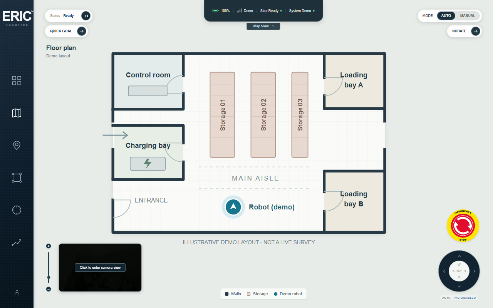

# Insight.IO robotics dashboard

Public repository: [Epsilen31/eric-robotics-dashboard](https://github.com/Epsilen31/eric-robotics-dashboard)

A locally hosted Angular 19 / Nx dashboard based on the supplied Insight.IO reference. The approved sidebar, emergency-stop artwork, camera layout, and clear floor plan are preserved. The dashboard includes an accessible 3D PCD viewer, working demo missions, and configurable ROS bridge integration.



[Mission preview](docs/screenshots/mission.png) ? [3D map](docs/screenshots/3d-map.png) ? [ROS map](docs/screenshots/ros-map.png) ? [ROS camera](docs/screenshots/ros-camera.png) ? [Mobile](docs/screenshots/mobile.png) ? [Actual demo recording](docs/demo/dashboard.webm)

## Run locally

Use Node.js 22.14 or newer and npm. Tested with Node 22.14 on Windows.

```sh
npm ci
npm start
```

Open http://localhost:4200. Restart an older running development server after installing the updated dependencies. This is an **Nx workspace**: use `npm start` or `npx nx serve insight-io`; `ng serve` cannot read this workspace's `project.json` configuration.

Build and self-host the production files:

```sh
npm run build
npm run serve:built
```

Open http://127.0.0.1:4202. The included static server supports byte-range requests for video. You can also serve `dist/insight-io/browser` using another static server. No CDN or external network connection is needed at runtime after dependencies are installed. Nx Cloud is not required.

## Try the complete demo

1. Open the dashboard. It starts with the clear, labelled **demo floor plan**.
2. Click **QUICK GOAL**, then an open floor area. Walls, rooms and storage racks are excluded from demo planning.
3. In **AUTO**, click **INITIATE**. The marker follows the highlighted grid-planned route and the mission reports completion.
4. Pause/resume with the mission button. The emergency button stops motion and clears the active route. Release the stop and explicitly initiate again to continue.
5. In **MANUAL**, hold W/S to drive forward/backward and A/D to turn, or hold the direction-pad buttons. Release, pause, stop, or losing focus cancels manual input. The local marker stays in walkable space.
6. Use the existing +/? slider or mouse wheel to zoom and drag to pan. Click the picture-in-picture preview to swap the camera and map. Selected views stay selected; AUTO is a robot mode, not a slideshow.

The sidebar keeps the reference artwork, with these working actions:

| Icon         | Action                                                           |
| ------------ | ---------------------------------------------------------------- |
| Dashboard    | Camera view                                                      |
| Map          | Clear floor plan in offline demo; live map when ROS is connected |
| Location pin | Quick-goal selection                                             |
| Region       | **3D Map View**: local PCD scan or live ROS cloud                |
| Target       | Recenter the current map and reset zoom                          |
| Trends       | **System and ROS settings**                                      |

The removed Reset view / 3D scan toolbar buttons remain removed. 3D access and recentering are provided through the sidebar.

## Run the local ROS simulator

In a second terminal:

```sh
npm run ros:demo
```

Open **System and ROS settings**, enter `ws://127.0.0.1:9090`, and click **Connect ROS**. The simulator needs no ROS installation or bag file. It publishes synthetic PointCloud2, PNG camera frames, pose, battery and mission feedback, and consumes velocity, goal, pause and stop commands. The displayed battery becomes 87%, and the live point cloud replaces the offline sample. Synthetic camera frames render the room and storage blocks from the robot pose, so moving or turning changes the image; a stationary robot keeps the same scene. Restart the mock server after changing its code.

Click QUICK GOAL, select a visible point in the live map, and INITIATE. The mock navigation model moves toward that goal. It is a protocol simulator with simple motion, not a physics or obstacle-avoidance simulator. Pause/stop are honored by the mock controller, and manual velocity commands have a 350 ms watchdog.

For a direct connection link, open `http://localhost:4200/?ros=ws://127.0.0.1:9090`. Choose **Use offline demo** in settings to disconnect.

For real ROS 2 and bag playback, topic configuration and controller integration, see [ROS integration](docs/ROS.md).

## Checks and capture

```sh
npm run test:unit
npm run test:e2e
npm run format:check
npm run build
```

Browser tests use separate local ports 4201 and 19090 so they do not reuse an older development build. On Windows they use installed Microsoft Edge. On Linux/macOS, install the Playwright Chromium browser once with `npx playwright install chromium` (Linux CI may need `--with-deps`). Browser installation needs internet; subsequent tests use only local services.

Unit tests cover point-cloud byte order, field offsets, row padding, invalid points, payload limits, and obstacle-aware demo planning. Browser tests cover pose-linked offline camera rendering, sidebar 3D access, goal selection, mission completion, pause/resume, stop, manual input, live ROS camera/telemetry/commands, disconnect handling, and mobile layout.

For video recording, install the small Playwright encoder once with `npx playwright install ffmpeg` (internet is only needed for that installation). To regenerate the implementation screenshots and video from the production build:

```sh
npm run build
npm run capture
```

Capture starts and stops its own static server (14202) and mock ROS server (19091), then writes `docs/screenshots/` and `docs/demo/dashboard.webm`.

## Architecture, assets and limits

- [Architecture and design decisions](docs/ARCHITECTURE.md)
- [Asset sources and licenses](src/assets/README.md)
- [Submission checklist](docs/SUBMISSION.md)
- [Validation record](docs/VALIDATION.md)

The assignment does not supply the original factory video or matching map. The video, PCL scan, illustrative floor plan and synthetic ROS environment are independent demo sources. The floor plan is not a reconstruction of the point cloud. Source changes are clearly labelled; no sample data is presented as a physical robot's live telemetry.

Real robot navigation requires a controller/adapter that consumes the documented goal, pause and stop topics and returns mission feedback. No physical robot or ROS bag was supplied, so hardware integration is not claimed as tested. The emergency control is a software stop; it is not a hardware safety circuit.

The production build passes with the existing initial-bundle warning (Three.js exceeds the 500 kB warning threshold but stays below the 1 MB error threshold). Dependency installation also reports audit findings in the existing framework/tooling stack; breaking dependency upgrades were not applied as part of this implementation.

The original local Git history was deleted before publication. The new repository records the completed source in logical commit batches; these commits do not represent the original development timeline.

The offline camera is a labelled local simulation rendered from the floor-plan robot pose and obstacles. It changes during manual and automatic movement, stays still when stopped, and needs no ROS server. The original sample video remains in assets but is no longer the default offline view.
